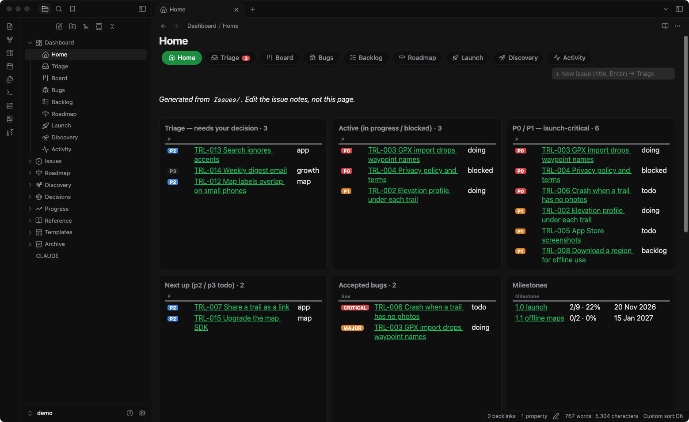
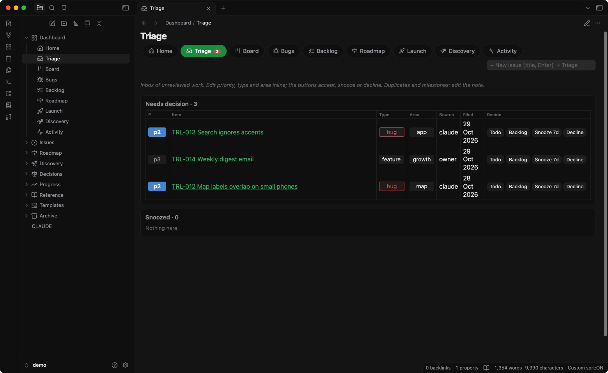
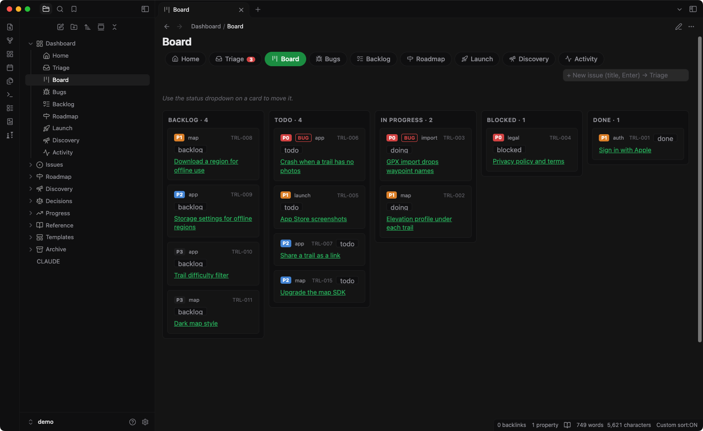

# Obsidian Product Vault

**Linear-style issue tracking in plain Markdown, inside Obsidian.** Issues, a triage inbox, a kanban board, bugs, backlog, milestones, discovery notes and decisions, all as notes you own. Optionally run by [Claude Code](https://claude.com/claude-code), which files, updates and links the notes for you while it works on your code.



| Triage | Board |
|---|---|
|  |  |

## Why

Small teams and solo builders often want Linear's discipline (one inbox, clear statuses, priorities, milestones) without another SaaS, seat prices or lock-in. Here every issue is a Markdown file with YAML frontmatter, and the dashboards are [Dataview](https://github.com/blacksmithgu/obsidian-dataview) queries over that frontmatter. It's diffable, greppable and works offline. Put it in git and you have full history. An AI coding agent can read and write it as easily as you can.

## What you get

- **Issues** (`Issues/ACME-001 Title.md`): `type` (task, bug, feature, chore), `status` (triage, backlog, todo, doing, blocked, done, cancelled), `priority` p0–p3, `severity` for bugs, `area`, `milestone`, `source`, plus an `## Activity` log at the bottom of each note.
- **Dashboards** (`Dashboard/`), with a tab bar and a quick "+ New issue" field that files straight into triage:
  - **Home**: what needs a decision, what's in progress, launch-critical work, next up, bugs, milestones, latest progress.
  - **Triage**: the inbox. Accept to Todo or Backlog, snooze 7 days, or decline, right from the table. Each choice is written to the issue's frontmatter and Activity log, with Undo.
  - **Board**: kanban by status. Move a card with the status dropdown on it.
  - **Bugs**, **Backlog** (priority editable inline), **Roadmap** (milestones with progress bars, features by now / next / later), **Launch** (the active milestone's issues as a board), **Discovery** (ideas and decisions), **Activity** (every issue's Activity lines in one feed).
- **Roadmap/** milestones (exactly one `active`), **Discovery/** ideas and research, **Decisions/** lightweight ADRs, **Progress/** weekly or release notes, **Reference/** product brief.
- **Templates/** for every note type (Obsidian's core Templates plugin).
- Folder and dashboard **icons** (Iconic), a fixed **folder order** (Custom File Explorer sorting) and a **dashboard stylesheet** (CSS snippet), all preconfigured.
- **`CLAUDE.md`** in the vault: the schema and working rules for AI agents (how to file, triage, link and log).

## Try the demo (2 minutes)

```bash
git clone https://github.com/agilek/obsidian-product-vault.git
```

In Obsidian: **Open folder as vault** → choose `obsidian-product-vault/demo` → **Trust author and enable plugins** → open `Dashboard/Home`.

The demo is a fictional hiking app, "Trailhead", with 16 issues, two milestones, ideas, a decision and a progress note. The plugins are included, so it works right away.

## Create your own vault

### Option A: with the script (macOS, Linux; needs `git`, `curl`, `rsync`, `python3`)

```bash
cd obsidian-product-vault
skills/product-vault/setup-vault.sh acme ACME            # → ~/Obsidian/product/acme, issues ACME-001…
PRODUCT_VAULTS=~/Notes skills/product-vault/setup-vault.sh acme ACME   # another parent folder
```

It copies `skills/product-vault/template/`, fills in the product name and issue prefix, downloads the three plugins at pinned versions and makes the first git commit. Then open the folder in Obsidian as above.

### Option B: by hand

1. Copy `skills/product-vault/template/` to a new folder.
2. Replace `{{PROJECT}}` with your product name and `{{PREFIX}}` with your issue prefix in all `.md` and `.js` files. These are outside `.obsidian/`; the `{{date:…}}` and `{{title}}` placeholders in `Templates/` are Obsidian's and stay.
3. Create the empty folders `Issues`, `Roadmap`, `Discovery`, `Decisions`, `Progress`, `Archive`.
4. Open it in Obsidian, trust the vault, then install **Dataview**, **Iconic** and **Custom File Explorer sorting** from Settings → Community plugins → Browse. Their settings are already in `.obsidian/plugins/*/data.json`, so you only need to install and enable them. You can also run `skills/product-vault/install-plugins.sh <vault>`.

**Tip:** dashboards are meant to be read in **Reading view** (`Cmd/Ctrl+E`). In editing view, Obsidian may show a dashboard's query code instead of the dashboard. The tabs in the dashboard bar always open Reading view. The demo opens every note in Reading view (Settings → Editor → Default view for new tabs).

Requires Obsidian 1.5 or later. Dataview JavaScript queries must be on; the template already turns them on.

## Use it with Claude Code (optional)

The repo is also a Claude Code plugin with one skill, `product-vault`. Claude then does the setup, migrates your repo's existing `TODO.md` into issues and keeps the vault current as it works.

```text
/plugin marketplace add agilek/obsidian-product-vault
/plugin install product-vault@obsidian-product-vault
```

Or install just the skill: `ln -s "$PWD/skills/product-vault" ~/.claude/skills/product-vault`.

Then, in your code repo, ask: *"Set up a product vault in Obsidian for this project and move TODO.md into it."* The skill:

- creates the vault and fills in your project's areas and product brief;
- migrates open items from `TODO.md` or similar into linked issues, milestones, ideas and decisions;
- adds a git-ignored `./vault` symlink to your repo and a pointer in its `CLAUDE.md`;
- wires a small hook (`vault-changes.py`, Python standard library only) into your repo's `.claude/settings.local.json`. When you move an issue in Obsidian, for example to `doing`, Claude sees the change on your next message and acts on it.

The rules Claude follows are in the vault's `CLAUDE.md`:

- Anything it discovers while working is filed in **triage** unasked.
- It never accepts or schedules triage items itself; that's your call.
- Saying `ACME-012` makes it read that issue first.
- A passing remark like "we should replace that icon" becomes an issue, an idea or a decision.
- Every note links to related notes both ways.

## How it works

The issue note is the data:

```yaml
---
id: ACME-012
title: "Search ignores accents"
type: bug
status: triage
source: claude
priority: p2
severity: minor
area: app
milestone:
created: 2026-10-29
updated: 2026-10-29
tags: [verify]
---
```

The dashboards are `dataviewjs` blocks that query `Issues/` and render tables and cards. Buttons and menus write back with Obsidian's `processFrontMatter` and append a line to the note's `## Activity` section. A triage issue embeds `Dashboard/triage-actions.js`, so you can also decide on it from the note itself.

**Customise:**
- **Areas:** list your own in the vault's `CLAUDE.md`. `area` is free text.
- **Colours and layout:** `.obsidian/snippets/dashboard.css`.
- **A new dashboard:** add it to the `pages` array at the top of each dashboard and to `Dashboard/sortspec.md`.

## Repository layout

```
skills/product-vault/
  SKILL.md             Claude Code skill (setup + migration instructions)
  setup-vault.sh       create a vault from the template
  install-plugins.sh   download Dataview, Iconic, Custom File Explorer sorting
  vault-changes.py     Claude Code hook: report issue changes made in Obsidian
  template/            the vault template ({{PROJECT}}, {{PREFIX}})
demo/                  example vault "Trailhead", plugins included
.claude-plugin/        Claude Code plugin + marketplace manifests
```

## Credits

The dashboards depend on these community plugins, each under its own license. The `demo/` vault includes their release builds unchanged.

- [Dataview](https://github.com/blacksmithgu/obsidian-dataview) by Michael Brenan (MIT)
- [Iconic](https://github.com/gfxholo/iconic) by gfxholo (MIT-0)
- [Custom File Explorer sorting](https://github.com/SebastianMC/obsidian-custom-sort) by SebastianMC (0BSD)

Not affiliated with Linear or Obsidian. Everything else here: [MIT](LICENSE).
